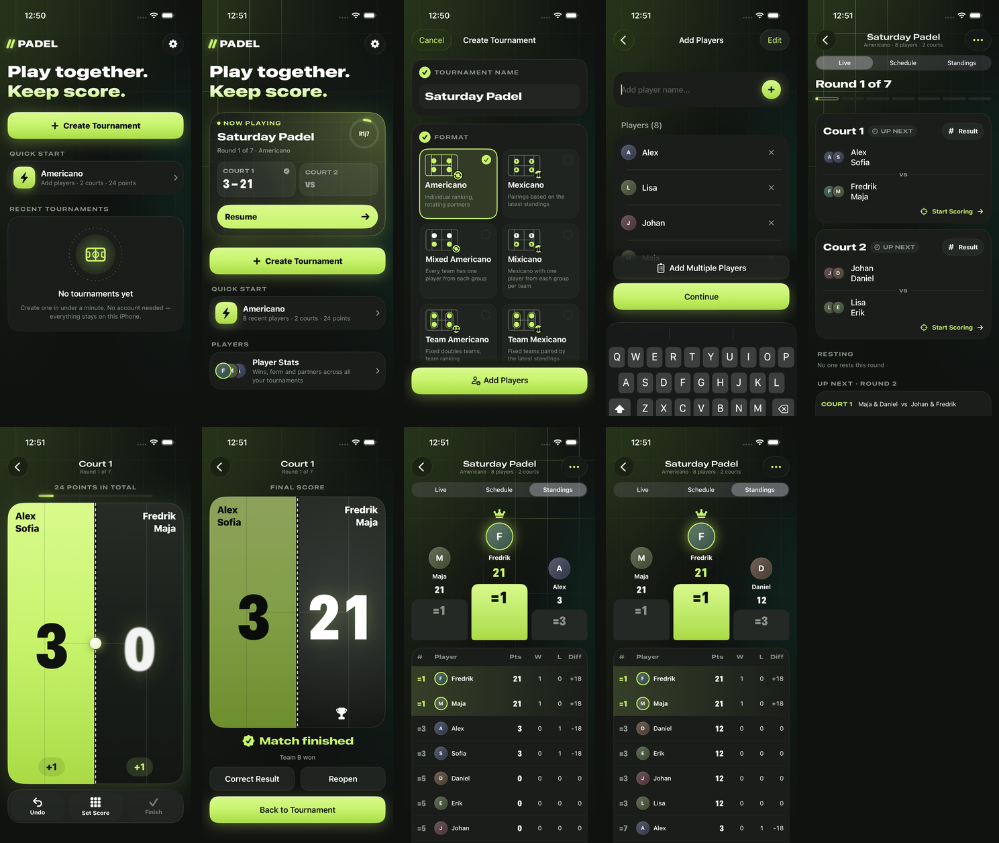
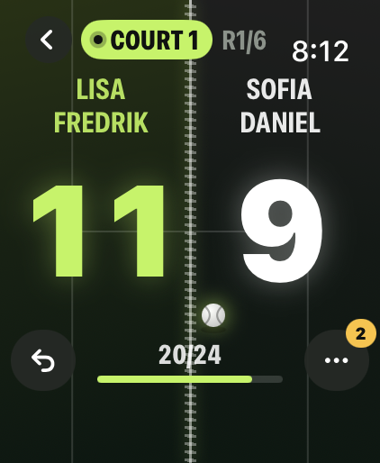
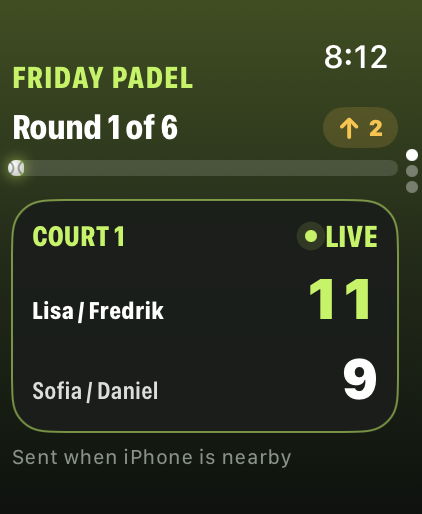
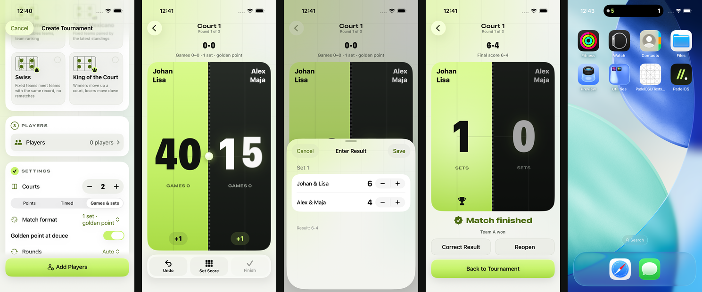
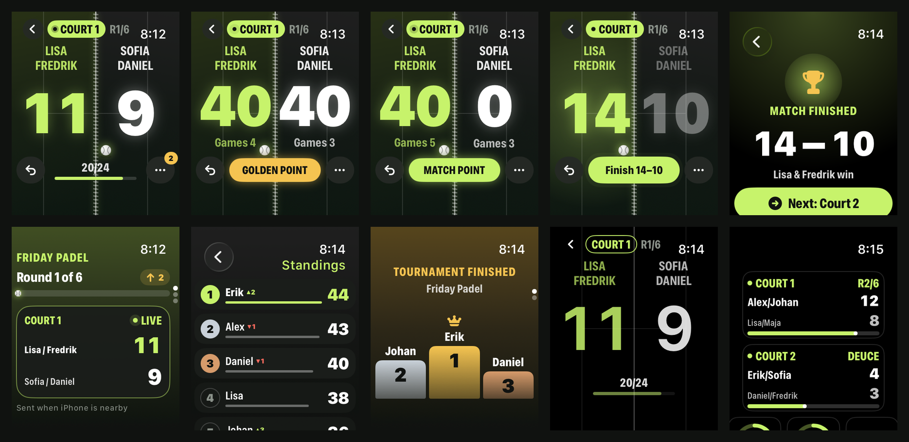
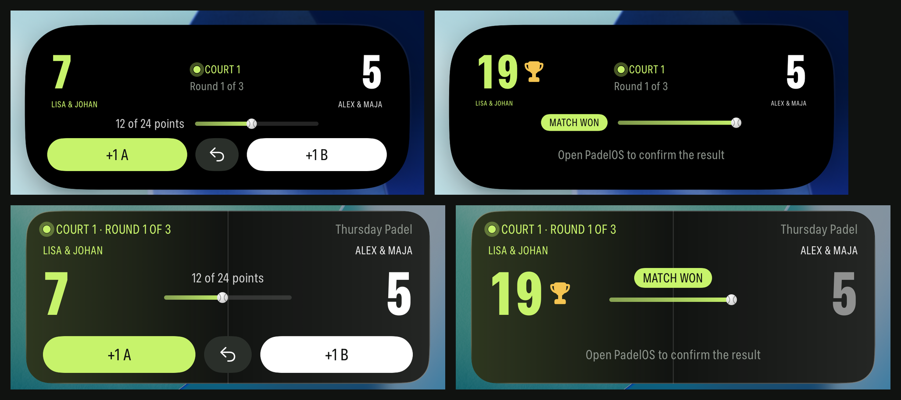
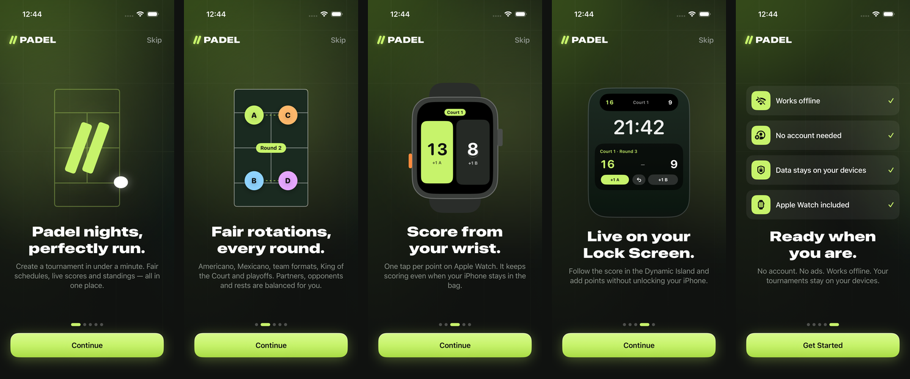
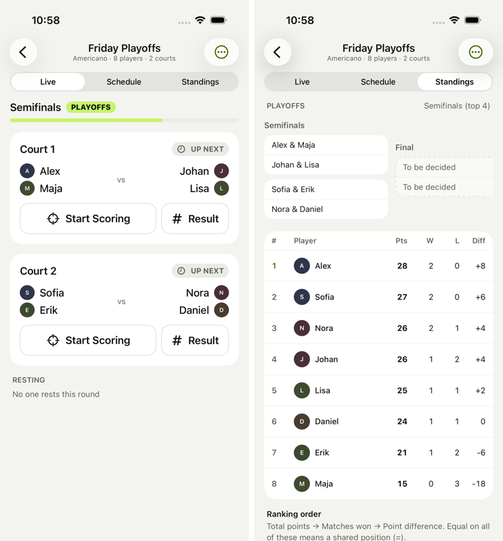
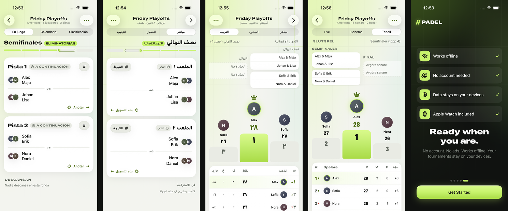

# PadelOS

The fastest way to run a padel tournament with friends — and keep score from your
Apple Watch.

- **iPhone**: create a tournament in under a minute, generate fair schedules, score
  matches, correct results, see live standings, share the final table.
- **Apple Watch** (optimised for Ultra): one tap per point, undo, offline scoring with
  automatic sync when your iPhone is back in range.
- **Formats**: Americano, Mexicano, Mixed Americano, Mixicano, Team Americano, Team
  Mexicano, Swiss and King of the Court — plus an optional standings-based final round
  or knockout playoffs (final, semifinals or quarterfinals) with a live bracket.
- **Scoring**: rally points to a fixed total, timed matches, or traditional games and sets
  (15/30/40, golden point or advantage, tie-breaks, super tie-break decider, short sets).
- **Live Activity**: the match you are scoring on the Lock Screen and in the Dynamic
  Island, with +1 and undo buttons that score without opening the app.
- **19 languages**: English, Spanish, Catalan, Portuguese (Portugal, Brazil), French,
  Italian, German, Dutch, Swedish, Danish, Norwegian, Finnish, Polish, Czech, Russian,
  Arabic, Japanese and Simplified Chinese.
- **Animated onboarding** on first launch (respects Reduce Motion).
- **No account, no backend, no internet required.** Everything stays on your devices.

| iPhone (dark) | Apple Watch Ultra |
| --- | --- |
|  |   |













Screenshots are captured automatically by CI from the simulator (UI tests and the watch
demo mode). The original design reference is in `docs/design/reference-mockup.png`.

## Requirements

- Xcode 16 or newer (Swift 6 toolchain), iOS 17+ and watchOS 10+ SDKs.
- For devices: an Apple Developer team for signing.
- The generated `PadelOS.xcodeproj` is committed, so you can open it directly. After
  adding files or editing `project.yml`, run `scripts/xcodegen.sh` (downloads the
  pinned [XcodeGen](https://github.com/yonaskolb/XcodeGen) 2.44.1) and commit both;
  CI fails when they disagree.

## Run

```sh
open PadelOS.xcodeproj
```

1. Select the **PadelOS** scheme and an iPhone simulator, press Run.
2. To run on devices: the team is set in `project.yml` (`DEVELOPMENT_TEAM`), so sign in
   to that team in Xcode → Settings → Accounts and run. Bundle IDs are
   `app.padelos.PadelOS`, `…widgets`, `…watchkitapp` and `…watchkitapp.widgets`; the
   watch app and complication share the App Group `group.app.padelos`. For another
   team, change `DEVELOPMENT_TEAM` (and, if the identifiers are taken, the prefix and
   group in `project.yml` and `ActiveMatchSnapshot.appGroup`), then run
   `scripts/xcodegen.sh`.
3. The watch app installs with the iPhone app (paired watch) or run the
   **PadelOSWatch** scheme on a watch simulator paired with an iPhone simulator.

## Test

```sh
# Domain, sync and persistence tests (macOS or Linux)
swift test --package-path Packages/PadelKit

# iPhone UI tests
xcodebuild test -project PadelOS.xcodeproj -scheme PadelOS \
  -destination 'platform=iOS Simulator,name=iPhone 16' CODE_SIGNING_ALLOWED=NO
```

## Ship to TestFlight

```sh
scripts/release/testflight-local.sh            # from a Mac, signed with your Xcode account
```

or Actions → **iOS TestFlight** → Run workflow (no Mac needed). One-time setup, secrets
and troubleshooting: [docs/RELEASE.md](docs/RELEASE.md).

See [TESTING.md](TESTING.md) for coverage and the device test checklist,
[ARCHITECTURE.md](ARCHITECTURE.md) for the design, and
[PROJECT_STATUS.md](PROJECT_STATUS.md) for what is verified.

## Repository layout

| Path | Contents |
| --- | --- |
| `Packages/PadelKit` | Shared Swift package: domain engine, sync protocol, persistence, stores |
| `Apps/iOS` | iPhone SwiftUI app |
| `Apps/Watch` | watchOS SwiftUI app and App Intent |
| `Apps/Shared` | Design tokens and formatting used by both apps |
| `Apps/iOSUITests` | XCUITest organiser journey, onboarding, playoffs |
| `Localization` | Source strings, translations per language (catalogs are generated) |
| `scripts` | Translation checker, String Catalog generator, pinned XcodeGen, Linux toolchain |
| `scripts/release` | TestFlight tooling: release checks, App Store Connect preflight, local deploy |
| `project.yml` | XcodeGen project specification (source of truth for `PadelOS.xcodeproj`) |
| `.github/workflows/ci.yml` | Linux checks, then macOS build, UI tests and screenshots |
| `.github/workflows/ios-testflight.yml` | Archive, sign and upload to TestFlight |
