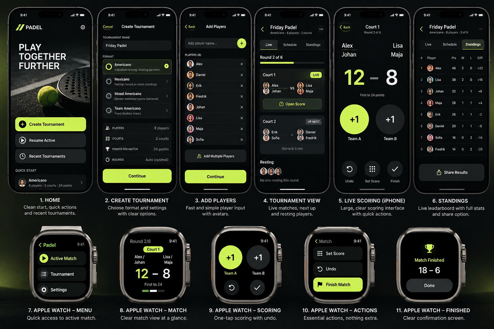

# PadelOS

The fastest way to run a padel tournament with friends — and keep score from your
Apple Watch.

- **iPhone**: create a tournament in under a minute, generate fair schedules, score
  matches, correct results, see live standings, share the final table.
- **Apple Watch** (optimised for Ultra): one tap per point, undo, offline scoring with
  automatic sync when your iPhone is back in range.
- **Formats**: Americano, Mexicano, Mixed Americano, Team Americano — plus an optional
  standings-based final round.
- **No account, no backend, no internet required.** Everything stays on your devices.



## Requirements

- Xcode 16 or newer (Swift 6 toolchain), iOS 17+ and watchOS 10+ SDKs.
- For devices: an Apple Developer team for signing.
- Optional: [XcodeGen](https://github.com/yonaskolb/XcodeGen) to regenerate the project
  after adding files (`xcodegen generate`). The generated `PadelOS.xcodeproj` is
  committed, so you can open it directly.

## Run

```sh
open PadelOS.xcodeproj
```

1. Select the **PadelOS** scheme and an iPhone simulator, press Run.
2. To run on devices: select the `PadelOS`, `PadelOSWatch` and `PadelOSWatchWidgets`
   targets → Signing & Capabilities → choose your Team. Bundle IDs are
   `app.padelos.PadelOS`, `…watchkitapp` and `…watchkitapp.widgets`; the watch app and
   complication share the App Group `group.app.padelos`. If those identifiers are taken
   in your account, change the prefix and group in `project.yml` (and
   `ActiveMatchSnapshot.appGroup`), then run `xcodegen generate`.
3. The watch app installs with the iPhone app (paired watch) or run the
   **PadelOSWatch** scheme on a watch simulator paired with an iPhone simulator.

## Test

```sh
# Domain, sync and persistence tests (macOS or Linux)
swift test --package-path Packages/PadelKit

# iPhone UI tests
xcodebuild test -project PadelOS.xcodeproj -scheme PadelOS \
  -destination 'platform=iOS Simulator,name=iPhone 16' CODE_SIGNING_ALLOWED=NO
```

See [TESTING.md](TESTING.md) for coverage and the device test checklist,
[ARCHITECTURE.md](ARCHITECTURE.md) for the design, and
[PROJECT_STATUS.md](PROJECT_STATUS.md) for what is verified.

## Repository layout

| Path | Contents |
| --- | --- |
| `Packages/PadelKit` | Shared Swift package: domain engine, sync protocol, persistence, stores |
| `Apps/iOS` | iPhone SwiftUI app |
| `Apps/Watch` | watchOS SwiftUI app and App Intent |
| `Apps/Shared` | Design tokens and formatting used by both apps |
| `Apps/iOSUITests` | XCUITest organiser journey |
| `project.yml` | XcodeGen project specification |
| `.github/workflows/ci.yml` | Linux + macOS CI |
